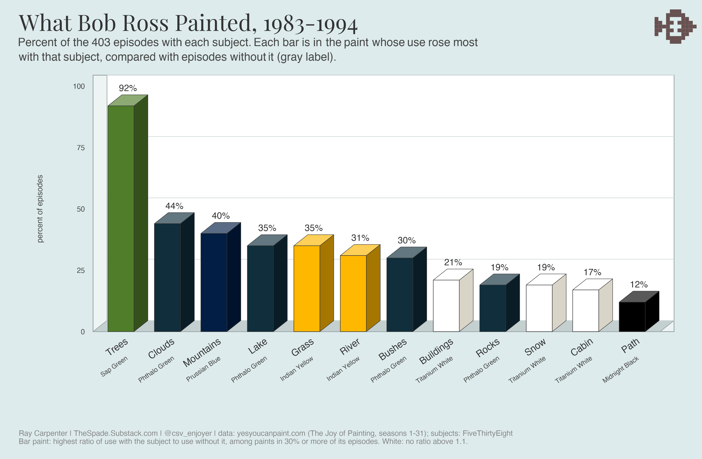
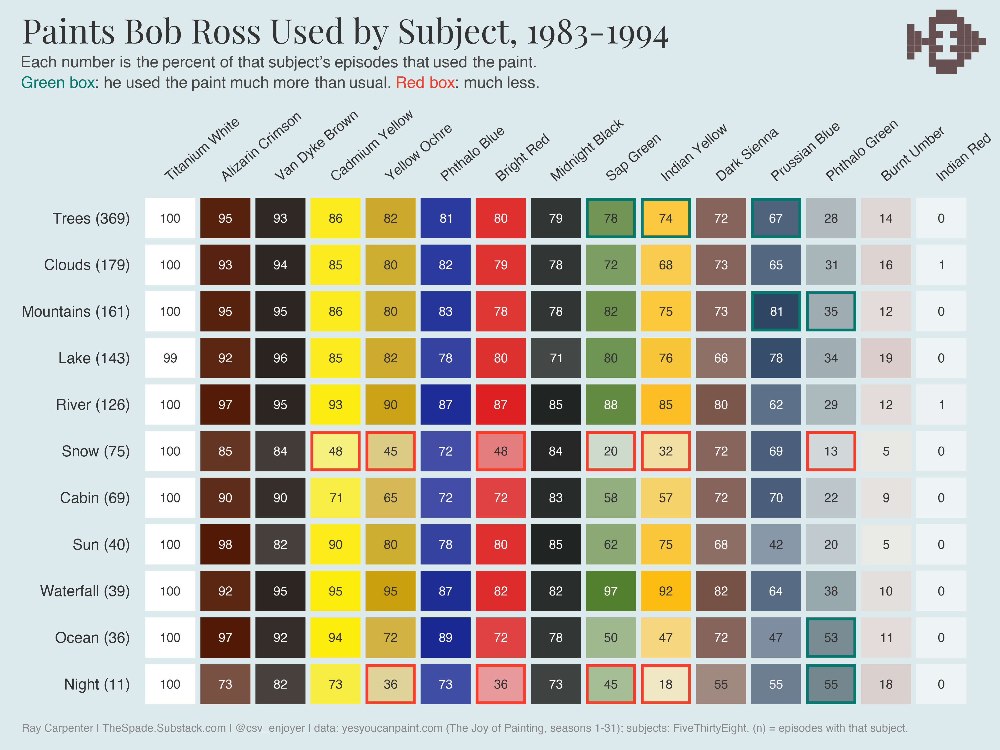
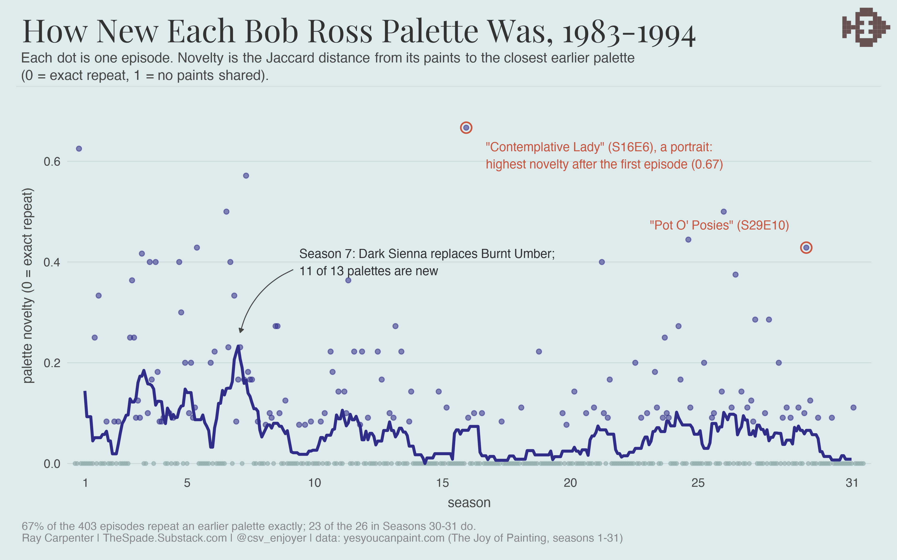
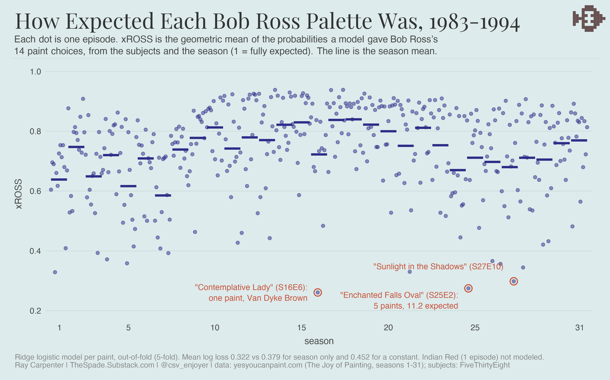

# bob_ross_db

A SQLite database of the paints Bob Ross used in each of the 403 episodes of
*The Joy of Painting* (31 seasons, 1983-1994), with a hex code for each paint
and FiveThirtyEight's tags for what each painting shows (trees, clouds,
mountains, cabins, and so on).

The database file is not checked in. Build it with:

```bash
./build.sh
```

This needs only `sqlite3`. The analysis and chart scripts need R.

## Contents

| File | Purpose |
|------|---------|
| `schema.sql` | Tables, indexes, and views |
| `colors.sql` | The 18 paints and their hex codes |
| `data/season_NN.sql` | Episodes and paint use for one season |
| `data/fivethirtyeight/elements-by-episode.csv` | FiveThirtyEight's subject tags, unchanged ([source](https://github.com/fivethirtyeight/data/tree/master/bob-ross)) |
| `elements.sql` | Loads that CSV into `elements` and `episode_elements` |
| `build.sh` | Rebuilds `bob_ross.db` from the files above |
| `analysis/` | Models and summaries (R) |
| `viz/` | Chart scripts (R) and the rendered PNGs |

## Schema

- **colors**: `id`, `name` (unique), `hex` (`#RRGGBB`, checked on insert).
  18 rows; Black Gesso, Liquid Black and Liquid Clear appear in no episode,
  so 15 paints are in use.
- **episodes**: `id`, `season`, `episode`, `title`, `youtube_url`. Unique on
  `(season, episode)`.
- **episode_colors**: one row per paint used in an episode (4,108 rows).
- **elements**: the 67 FiveThirtyEight tags, lowercased (`tree`, `clouds`,
  `cabin`, frame types, guest painters).
- **episode_elements**: one row per tag on an episode (3,221 rows).
- **v_episode_palette**: season, episode, title, color, hex.
- **v_episode_elements**: season, episode, title, element.

## Example queries

```sql
-- The palette for one episode
SELECT color, hex FROM v_episode_palette WHERE season = 1 AND episode = 1;

-- Episodes per paint
SELECT c.name, c.hex, COUNT(*) AS episodes
FROM colors c JOIN episode_colors ec ON ec.color_id = c.id
GROUP BY c.id ORDER BY episodes DESC;

-- Episodes with the fewest paints
SELECT season, episode, title, COUNT(*) AS n_colors
FROM v_episode_palette GROUP BY season, episode ORDER BY n_colors;

-- Percent of mountain paintings that use each paint
SELECT p.color, ROUND(100.0 * COUNT(*) / (
         SELECT COUNT(*) FROM v_episode_elements WHERE element = 'mountain'), 1) AS pct
FROM v_episode_palette p
JOIN v_episode_elements x USING (season, episode)
WHERE x.element = 'mountain'
GROUP BY p.color ORDER BY pct DESC;
```

## Analysis

Run each script from the repo root after `./build.sh`. Each one saves an `.rds`
file (not checked in) that its chart script reads.

- `explore.R`: k-medoids clusters of palettes (Jaccard distance on the 403 x 15
  paint matrix) and paint use by title keyword (Fisher tests, BH-corrected).
  With k = 3, the clusters are the Burnt Umber palette of Seasons 1-6, the
  12-paint palette of later seasons, and a winter palette from all eras.
- `snow_predict.R`: predicts a snow scene (a title with Winter, Snow, Frost,
  Frozen, Christmas or Wintry; 55 episodes) from the palette. A logistic model
  on one input, the count of six warm and green paints, has a cross-validated
  AUC of 0.90 (stratified 5-fold). Of the 46 episodes with neither Cadmium
  Yellow nor Sap Green, 32 (70%) are snow scenes.
- `novelty.R`: for each episode, the Jaccard distance from its palette to the
  closest earlier palette (0 = exact repeat). The season mean falls from 0.14
  in Season 1 to 0.01 in Season 31. 67% of episodes repeat an earlier palette
  exactly. Season 7, when Dark Sienna replaced Burnt Umber, has the highest
  season mean (0.23); 11 of its 13 palettes are new.
- `xross.R`: xROSS, an expected-palette model. See below.

### xROSS

For each paint, a ridge logistic regression gives the probability that the
paint is on the palette, from the episode's subjects (FiveThirtyEight tags,
grouped as in `viz/_subjects.R`), guest, frame, winter and portrait flags, and
the season (natural spline, 4 df). The ridge penalty is chosen per paint by
5-fold cross-validation, and every prediction is out of fold. Indian Red, used
once, gets the base rate 1/403.

Per episode:

- **xROSS**: the geometric mean of the probabilities the model gave Bob Ross's
  actual yes/no choice for each of the 14 modeled paints. 1 means every choice
  was fully expected.
- **POE** (paints over expected): the number of paints used minus the sum of
  the predicted probabilities.

Mean out-of-fold log loss per paint is 0.322, against 0.379 for a season-only
model and 0.452 for a constant. The subjects matter most for the warm paints:
Sap Green's AUC is 0.90 with subjects and 0.53 with season alone, Yellow Ochre's
0.87 and 0.61, Cadmium Yellow's 0.85 and 0.53.

The season mean of xROSS is 0.64 in Season 1, lowest in Season 7 (0.59), and
highest in Seasons 17-18 (0.84). The lowest single episodes are "Contemplative
Lady" (S16E6, 0.26), a portrait in Van Dyke Brown only, and "Enchanted Falls
Oval" (S25E2, 0.28), with 5 paints against 11.2 expected. "Icy Lake" (S24E9)
has the highest POE: 11 paints against 6.1 expected.

## Charts

Run from the repo root, for example `Rscript viz/color_pie.R`.
`subjects_3d.R`, `paints_by_subject.R` and `xross.R` use the subject groups in
`viz/_subjects.R` (for example, `tree`, `trees`, `conifer`, `deciduous` and
`palm_trees` all count as "Trees").







## Adding a season

Copy the pattern in `data/season_01.sql`: insert the episodes, then link paints
by name. Add any new paint to `colors.sql`, then run `./build.sh`.

## Sources

**Paint use per episode**:
[yesyoucanpaint.com](https://yesyoucanpaint.com/), seasons 1-31.

**Hex codes**: the set in Jared Wilber's
[Bob Ross Paintings](https://github.com/jwilber/Bob_Ross_Paintings) data (also
the [TidyTuesday 2023-02-21](https://github.com/rfordatascience/tidytuesday/tree/master/data/2023/2023-02-21)
dataset), built from [Two Inch Brush](https://www.twoinchbrush.com/). Two values
differ here. That set gives Phthalo Blue as `#0C0040` and Sap Green as
`#0A3410`; mixed with white, these read as violet and kelly green. This repo
uses the pigment values from Wikipedia: Phthalo Blue `#000F89`
([copper phthalocyanine](https://en.wikipedia.org/wiki/Copper_phthalocyanine))
and Sap Green `#507D2A` ([sap green](https://en.wikipedia.org/wiki/Shades_of_green#Sap_green)).

**Subject tags**: Walt Hickey,
[A Statistical Analysis of the Work of Bob Ross](https://fivethirtyeight.com/features/a-statistical-analysis-of-the-work-of-bob-ross/)
(FiveThirtyEight, 2014). The CSV is copied unchanged from
[fivethirtyeight/data](https://github.com/fivethirtyeight/data/tree/master/bob-ross)
under [CC BY 4.0](https://github.com/fivethirtyeight/data/blob/master/LICENSE).
FiveThirtyEight tagged what each painting shows but not the paints; this repo
joins the two.

Episodes join on season and episode number, and all 403 match. About 30 titles
are spelled differently in the two sources ("Snowfall" and "Snow Fall");
`episodes.title` keeps this repo's spelling. Any tree tag (`tree`, `trees`,
`conifer`, `deciduous`, `palm_trees`) is on 91.6% of episodes, `clouds` on 44.4%
and `mountain` on 39.7%.
