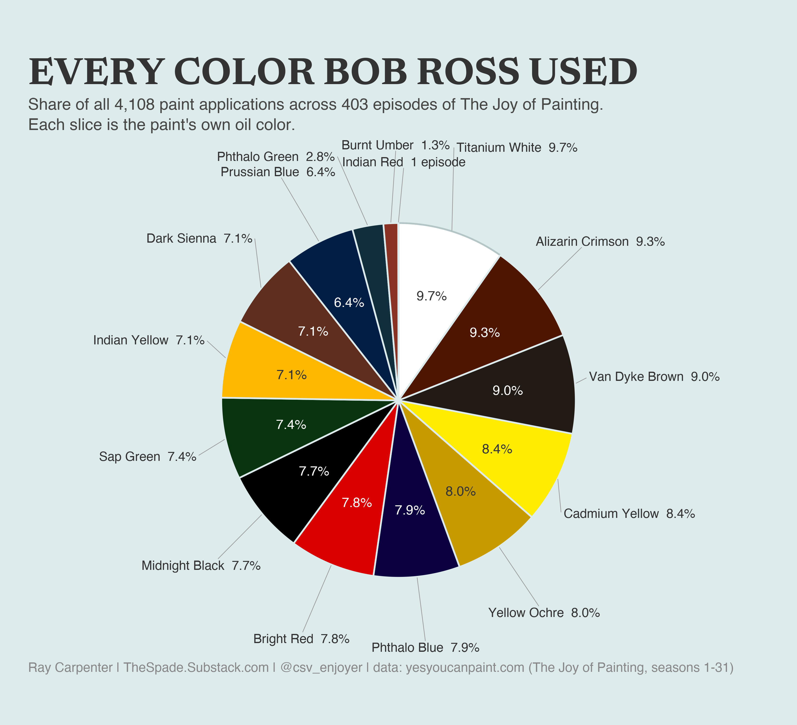
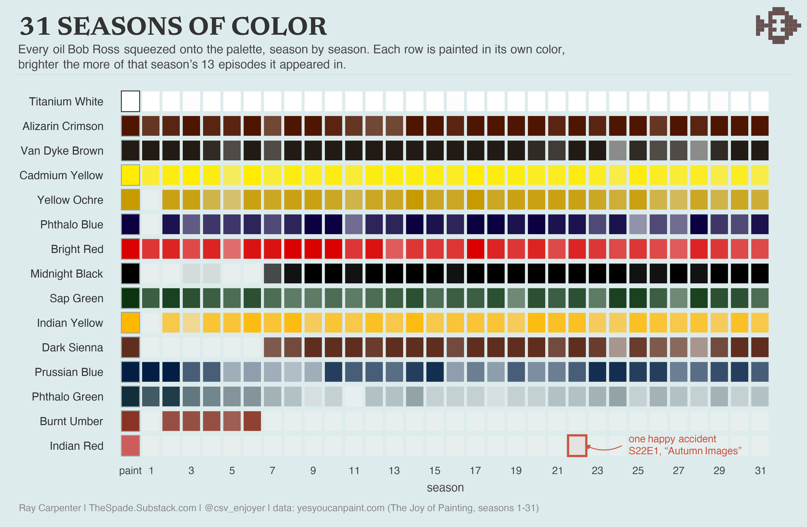
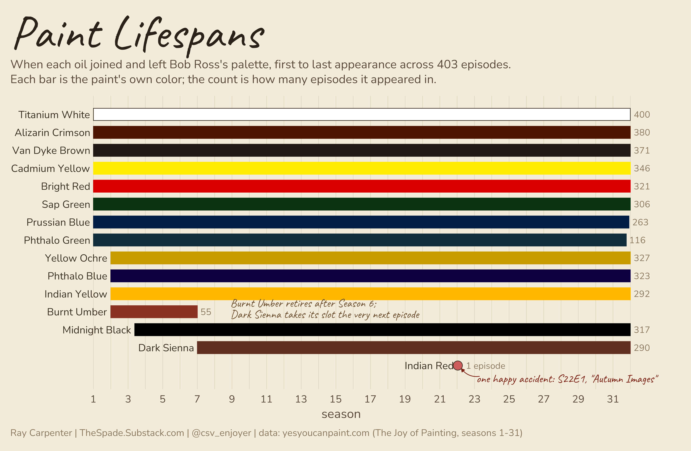
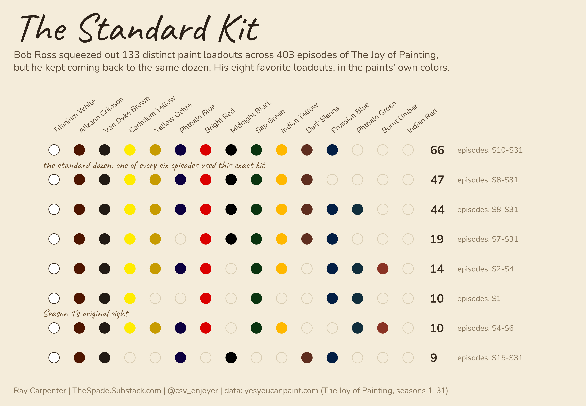
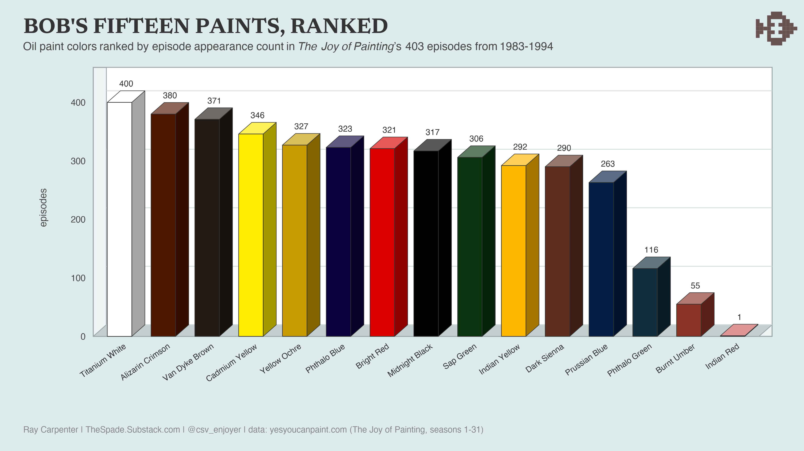
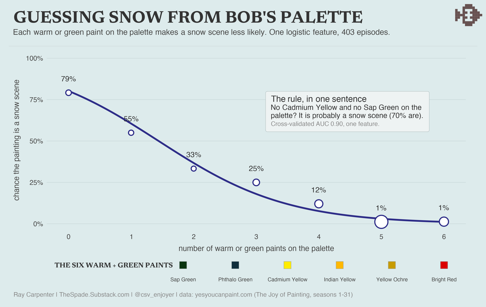

# bob_ross_db

A SQLite database of every paint color Bob Ross used in each episode of
*The Joy of Painting*, with hex codes.

## Layout

| File | Purpose |
|------|---------|
| `schema.sql` | Tables, indexes, and the `v_episode_palette` view |
| `colors.sql` | Canonical paint palette + hex codes |
| `data/season_NN.sql` | Episodes and color usage for one season |
| `build.sh` | Rebuilds `bob_ross.db` from the SQL files |
| `analysis/` | Palette clustering, subject/palette association, snow-scene model |
| `viz/` | Chart scripts (R) and rendered PNGs |

The `.db` is gitignored — rebuild it locally:

```bash
./build.sh
```

## Schema

- **colors** — `id`, `name` (unique), `hex` (validated `#RRGGBB`)
- **episodes** — `id`, `season`, `episode`, `title`, `youtube_url` (unique on `season, episode`)
- **episode_colors** — junction of `episode_id` ↔ `color_id`
- **v_episode_palette** — flattened view: season, episode, title, color, hex

## Example queries

```sql
-- Full palette for one episode
SELECT color, hex FROM v_episode_palette WHERE season = 1 AND episode = 1;

-- How many episodes each color appears in
SELECT c.name, c.hex, COUNT(*) AS episodes
FROM colors c JOIN episode_colors ec ON ec.color_id = c.id
GROUP BY c.id ORDER BY episodes DESC;

-- Episodes using the fewest colors
SELECT season, episode, title, COUNT(*) AS n_colors
FROM v_episode_palette GROUP BY season, episode ORDER BY n_colors;
```

## Analysis

Two scripts in `analysis/`, both run from the repo root after `./build.sh`:

- `explore.R` — k-medoids palette archetypes (Jaccard distance over the 403×15
  presence matrix) and subject→palette association from keyword-tagged titles
  (Fisher tests, BH-corrected). Three archetypes fall out: the early Burnt Umber
  palette (S1–6), the later standard kit, and a cross-era winter palette.
- `snow_predict.R` — can you guess a snow scene from the palette alone? A
  one-feature logistic (count of warm/green paints present) hits 0.90 AUC under
  stratified 5-fold CV. The depth-2 tree version: no Cadmium Yellow and no Sap
  Green → 70% chance it's a snow scene.

Each saves an `.rds` (gitignored) that the corresponding chart script reads.

## Charts

Scripts in `viz/`, run from the repo root (`Rscript viz/color_pie.R`).








## Adding a season

Create `data/season_NN.sql` following the Season 1 pattern (insert episodes, then
link colors by name), add any new colors to `colors.sql`, and re-run `./build.sh`.

## Color source

Hex codes follow the widely-used canonical Bob Ross palette
([Two Inch Brush](https://www.twoinchbrush.com/) / FiveThirtyEight reference set).
